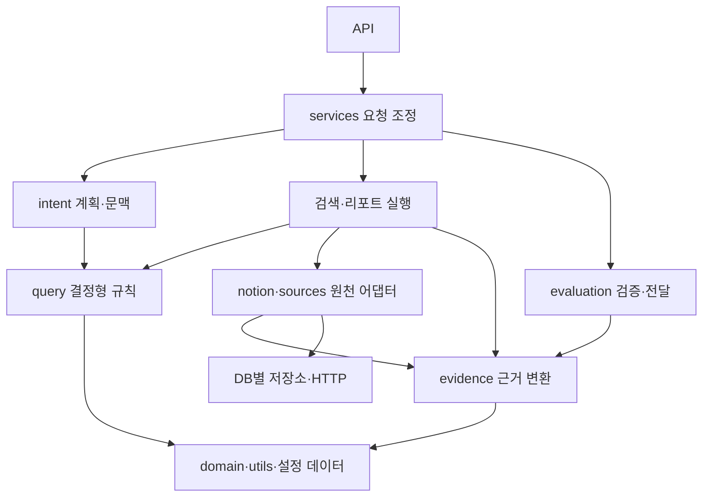

# 기존 동작을 보존하는 전체 구조 개선 설계

작성일: 2026-10-30 · 상태: 검토 가능한 설계안, 구현 미착수

## 1. 목적과 범위

질문 해석, 검색, 답변 검증, 리포트, 프런트엔드, 저장소의 책임과 의존 방향을 정리한다. 사용자가 보는 답변과 화면, API 계약, 인증·권한, 저장 데이터는 유지한다. 구조 개선의 성공은 파일 수나 줄 수보다 독립적으로 이해·검증할 수 있는 경계와 재발 방지 규칙으로 판단한다.

이 문서는 지금까지의 대화와 현재 작업 트리를 근거로 한 제안이다. 실행 계획은 `docs/superpowers/plans/2026-10-30-architecture-refactor.md`에 있다. 이번 작업에서는 문서만 작성하며, 실행·배포·데이터 변경을 포함하지 않는다.

### 반드시 보존할 동작

| 영역 | 보존 계약 |
|---|---|
| 해석·라우팅 | source/operation/report_kind, 조건의 포함·제외, 날짜 필드·경계, 따옴표 안 제목, 후속 질문의 유지·교체·해제, 현재 플래너 플래그별 분기 |
| 검색·리포트 | 필터 적용 범위, 정렬·동률 순서, 중복 제거, 제한값·페이지 처리, 합계·공수 계산, 실시간/저장본 폴백, 불완전성·최신성 표시 |
| 답변·검증 | 근거의 이슈·노트·필드·날짜, 인용 원문, 검증 차단·명확화, 결정형 문구, 모델 요청 프롬프트와 옵션, A/B 비교와 후속 질문 |
| 요청 실행 | SSE 이벤트 종류·순서, 취소·타임아웃·재시도·rate limit, admission, 감사 로그의 횟수와 사용자 범위 |
| Notion | DB 발견·허용 범위, 제목·속성·본문 검색, 권한이 사라진 페이지의 배제, 커서·부분 수집, 쓰기 확인 절차 |
| 프런트엔드 | 화면·스타일·키보드·포커스, 초기 로딩 순서, 대화 선택·삭제·되돌리기·동기화, 스트림 중 화면 전환, 관리자 권한 |
| 저장소·설정 | DB 파일·테이블·버전·보존 데이터, 환경변수 이름·기본값·설정 우선순위, 고객사 별칭과 사용자 표시명 |

점수·라우팅·타임아웃·캐시 TTL·권한 정책·UI 디자인의 개선은 별도의 동작 변경이다. 필요성이 발견되어도 이 계획의 `refactor` 변경에 섞지 않고 별도 `fix`/`feat`로 제안한다.

## 2. 확인된 현황과 해석의 한계

2026-10-30 작업 트리의 Python AST에서 명시적 import를 분석했다. 함수 내부 import를 포함하고, `from package import module`은 실제 모듈 존재 여부로 해석했다. 동적 import, 모듈 별칭 치환, 패키지 초기화의 암묵적 효과는 별도로 점검해야 하므로 이 숫자가 모든 실행 의존성을 증명하지는 않는다.

| 항목 | 확인 결과 |
|---|---|
| 가장 큰 강결합 요소(SCC) | 29개: intent 14, notion 13, query_planning, team_scope |
| 함수 밖 명시적 import의 SCC | 0개. 현재 ImportError가 발생한다는 증거로 사용하지 않는다. |
| 함수 내부 프로젝트 import | 218문. 표준·외부 라이브러리를 포함하면 236문. 모두 제거할 목표는 아니다. |
| common 의존 모듈 | 63개. 범용 순수 함수의 높은 참조 수 자체는 결함이 아니다. |
| 동적 호환 조회 | 구현 4개, 실제 호출 26곳 |
| 기존 구조 검사 | 공개 경로·재내보내기 소유 모듈·일부 함수 위치·동작을 검사한다. 순환/계층 금지 검사는 없다. |
| 설정 | config import 시 JSON 로딩. 네트워크는 get_notion_settings 호출 시 조건부 DB 발견에서 발생한다. |
| 정적 자산 | JS는 no-store, 나머지는 no-cache. ECharts의 앱 내 참조는 발견하지 못했다. |

동적 호환 조회의 전체 범위:

| 구현 | 호출 수 | 참조하는 호환 모듈 |
|---|---:|---|
| notion/compat.py | 15 | backend.notion.core |
| evaluation/comparison.py | 4 | backend.evaluation.core |
| evaluation/finalization.py | 6 | backend.evaluation.core |
| intent/context.py | 1 | backend.intent.core |

큰 순환 외에도 아래 7개 SCC를 확인했다. 전체 개선 완료 범위에 포함한다.

| SCC | 소유 작업 |
|---|---|
| sources.mantis / mantis_search_projection / mantis_store / tools.mantis_snapshot | P5-B |
| reports.similar / comparison_facts / comparison_history / comparison_narrative | P5-A |
| evaluation.comparison / core / finalization / verification | P1-B |
| reports.team_brief / workspace | P6 |
| reports.effort / effort_trend | P5-A |
| evaluation.explanation_direct / explanation_quotes | P5-A |
| services.chat_service / unified_planning | P5-C |

## 3. 접근 방식

검토한 방법은 대규모 일괄 재편, 파일 크기 중심 분할, 동작 계약을 유지한 경계별 이전이다. 일괄 재편은 실패 원인과 되돌릴 범위가 커지고, 줄 수 중심 분할은 기존 의존성을 새 파일에 옮길 수 있다. 이 계획은 **경계별 이전**을 제안한다. 이는 사용자의 기존 동작 보존 요구에 근거한 설계 선택이며, 별도 프레임워크 도입이나 전체 재작성을 전제하지 않는다.

기본 순서는 `동작 기준선 → patch 경로 이전 → 동적 조회 제거 → 책임 분리 → 사용처 소진 → 파사드 폐기`다. 단순 재내보내기는 이전 중에 유지할 수 있다. 구현·테스트·외부 스크립트가 새 경계를 사용하기 전에 옛 공개 경로부터 지우지 않는다.

## 4. 목표 의존 구조

화살표는 import 또는 명시적인 호출 의존 방향이다. 같은 계층의 모든 상호 참조를 허용한다는 뜻은 아니다. 실제 금지 규칙은 역할별로 적용한다.

- `utils/*`, 결정형 `query/*`, 공통 `evidence/*`는 `services`, `api`, 검색 오케스트레이터, 호환 파사드를 import하지 않는다.
- `query/*`는 HTTP·SQLite·모델 호출을 하지 않는다. 명단·날짜 같은 입력은 값으로 전달한다.
- `intent/*`는 `notion.search`, 원천 HTTP 클라이언트, 상위 플래너를 다시 부르지 않는다. 공통 명단 조회는 별도 저장소가 소유한다.
- `notion`의 transport·값 변환·스키마 캐시는 search·갱신 오케스트레이터를 import하지 않는다.
- `reports/*`와 `sources/*`는 `evaluation`의 인용·단계 판정 구현을 가져오지 않는다. 공유 근거 처리를 `evidence/*`가 소유한다.
- 리포트의 결과 정리 함수는 `retrieval.py`, 조건 표시 함수는 `answers.py`를 통해 가져오지 않는다.
- `services`가 원천과 리포트를 조합한다. 하위 실행 단계가 `chat_service`로 역참조하지 않는다.
- 생산 코드와 일반 테스트는 폐기 대상 파사드를 새로 참조하지 않는다. 호환 검사만 한시적으로 예외다.
- `__init__.py`는 가볍게 유지한다. 파일 이동 후 거대한 재내보내기 집합을 새로 만들지 않는다.

## 5. 파사드·테스트 이전 계약

폐기 후보는 `understanding.py`, `sources/notion.py`, `reports/evaluation.py`와 연결된 `intent/core.py`, `notion/core.py`, `evaluation/core.py`다. `common.py`, `config.py`, `query_planning.py`는 책임 이전 중 기존 이름을 제공할 수 있지만, 새 동적 디스패치 파사드로 만들지 않는다. 각 파일을 삭제할지 작은 실제 구현으로 남길지는 P9 소유권 목록으로 확정한다.

기존 `test_architecture_contracts.py`를 세 목적에 따라 나눈다.

1. **동작 계약:** 계획·답변·근거의 golden fixture 검사는 유지하고 새 실제 경로로 이전한다.
2. **한시적 호환 계약:** 옛 심볼의 사용 가능 여부는 `test_legacy_import_contracts.py`에서 유지한다. 제거 조건과 담당 단계를 기록한다. 내부 `__module__` 위치 변경 자체를 동작 회귀로 취급하지 않는다.
3. **목표 구조 계약:** 순환, 금지 방향, 새 파사드 의존, 운영 코드의 monkeypatch 탐색을 검사한다. 이전이 끝난 경계부터 강제한다.

patch는 정의 위치가 아니라 **실제 소비 모듈이 이름을 조회하는 위치**로 옮긴다. HTTP·모델·저장소 등 필요한 경계만 대체하고, 검증 대상 함수 전체를 mock하여 동작 검사를 무력화하지 않는다. 이전 테스트에서 외부 호출 0건, fake 호출 횟수·인수·반환 처리까지 확인한다.

동적 조회 제거와 단순 import 호환성 제거는 독립된 완료 조건이다. 전자를 없애고도 후자를 잠시 유지할 수 있다. 기존 검사 삭제만으로 통과시키거나, fixture를 현재 출력으로 일괄 덮어쓰지 않는다.

## 6. 주요 책임 분리

| 현재 위치 | 새 소유권 제안 |
|---|---|
| common.py | utils의 문자열·숫자·날짜, domain의 고객사·사람 규칙, sources의 Chroma 문서 포맷, 기존 mantis_status의 상태 표시 |
| config.py | 설정값/정적 목록, 고객사 JSON 로더, notion transport·discovery. 네트워크를 허용하는 설정 해석은 이름으로 드러낸다. |
| query_planning.py | query의 연산·기간 규칙과 intent의 계획 조합. dict 키와 함수 시그니처는 이전 중 보존한다. |
| notion/search.py | 조건·용어 해석, 매칭·정렬, 서버 필터, 후보 검색, 검색 조정. 점수와 필터 순서 유지. |
| notion client·mapping·snapshot | 원시 값 변환, HTTP, schema cache, crawl 요청/예산, coverage, 후보 매칭, 갱신 조정으로 나눈다. |
| explanation_quotes/direct | 근거 발췌·출처·단계 판정은 evidence, 검증은 evaluation, 답변 렌더링은 reports로 나눈다. |
| retrieval.py | 검색 실행과 결과 정리·모델 컨텍스트 변환을 분리한다. |
| sources/mantis.py | 필드/정규화·매칭, HTTP, 저장본 조회, 검색 실행으로 나눈다. |
| chat_service.py | 준비·계획·검색·생성·최종 전달 단계. 기존 실행 컨텍스트와 요청 경계를 유지한다. |
| workspace.js/events.js/chat.js | 상태 전이, 대화 저장·동기화, 화면 렌더링, 이벤트 연결. bootstrap이 조합한다. |
| styles.css | 기존 cascade 순서를 보존하는 연속 구간 추출. 기존 분리 CSS와 중복 책임을 확인한다. |

## 7. 저장소와 프런트엔드 원칙

SQLite는 DB별 schema owner와 연결 프로필을 둔다. 인증, 감사, workspace, Notion actions/body index, Mantis 저장본·검색 인덱스, Chroma 소유 DB를 구분한다. 공통 연결 도우미는 연결 생성·옵션 적용을 소유하고, DB별 프로필은 현재 옵션을 보존한다. 첫 이전에서는 close·commit·rollback과 BEGIN IMMEDIATE의 호출 경계를 그대로 유지한다. WAL·timeout·동기화·읽기 전용 모드를 일률 변경하지 않는다.

파일 이동만 하는 단계에서는 migration 번호·순서·SQL을 바꾸지 않는다. 별도 체계를 쓰는 캐시 DB는 version 0/기존 테이블 여부를 먼저 조사하고, 공용 runner 강제 적용이나 재생성을 하지 않는다. Chroma 같은 외부 소유 schema는 애플리케이션 migration 대상으로 편입하지 않는다.

프런트엔드는 현재 ES 모듈을 유지한다. 상태의 단일 소유자와 의미가 있는 변경 함수로 전이를 모은다. 임의 `setState` 호출로 직접 대입을 대체하지 않는다. DOM·AbortController·타이머 같은 실행 자원은 수명과 정리 책임을 별도로 둔다. 초기화는 bootstrap에서 명시적으로 수행한다.

정규식 소스 변환·함수 잘라내기 테스트는 실제 모듈 로딩과 필요한 외부 경계 stub으로 이전한다. 모듈 그래프 자체를 모두 stub하면 순환·초기화 오류를 놓치므로, 실제 내부 모듈을 연결하는 통합 검사와 브라우저 smoke도 유지한다.

`?v=` 제거는 모든 내부 모듈 URL의 일관성을 확인하는 한 단계로 수행한다. 현재 HTTP 캐시 정책과 앱 버전 안내는 유지한다. 이미 열린 탭의 메모리 모듈까지 갱신된다고 가정하지 않는다. 자산 배포는 현재 배포 방식에서 파일 집합의 일관성이 보장되는지 확인한다.

## 8. 검증·완료 기준

필수 명령은 저장소 루트의 `assistant_web/scripts/check.sh`이며, 단계는 `tests compile shell ruff mypy audit`다. Python은 `assistant_web/.venv/bin/python`(3.12), 기존 커버리지 하한은 72%다. Node 부재로 프런트 검사가 skip된 실행은 프런트 단계의 통과 증거로 인정하지 않는다.

새 테스트는 소스 배치 자체보다 경계에서 유지해야 하는 동작과 실패를 검증한다. 구조 규칙 검사는 별도의 AST/ES 모듈 그래프 검사로 명시한다. 전체 파일 줄 수, 함수 내부 import 0개, 직접 connect 0개 같은 단일 숫자를 성공 기준으로 삼지 않는다.

최종 목표는 명시적 생산 Python/내부 ES 모듈 그래프의 runtime SCC 0개, 동적 호환 조회 구현·호출 0개, 폐기 확정 파사드의 생산·일반 테스트 참조 0개다. TYPE_CHECKING 의존은 별도 집계하고, 의도적인 동적 로딩은 목록과 호출 검증으로 다룬다. 기존 예외를 자동 재생성해 실패를 숨기지 않는다.

결정형 출력은 고정 입력·시간·fake 응답으로 전후 비교한다. 실제 모델 응답의 문장 완전 일치는 요구하지 않으며, 같은 모델 설정·고정 원천·문항을 사용해 조건·ID·수치·근거·차단 여부를 비교한다. 외부 데이터가 바뀐 결과는 구조 회귀 증거와 섞지 않는다. 회사 모델로 필요한 이슈 원문을 보내는 검증은 기존 사용자 승인 범위다.

성능은 먼저 기준선을 측정한다. 모델·원천 호출 횟수, 재시도 수, 캐시 적중, DB 쿼리 수가 의도 없이 늘면 중단한다. 지연시간은 같은 입력으로 반복 측정해 기준선 변동 범위를 벗어난 경우 원인을 조사하며 임의의 새 SLA를 만들지 않는다.

## 9. 작업·롤백 원칙

- 메인 에이전트가 직접 수행한다. 별도 사용자 요청 없이 서브에이전트를 생성하거나 재개하지 않는다.
- 현재 작업 트리에 사용자 변경이 다수 있다. 실행 기준선은 HEAD만이 아니라 인수한 작업 트리를 식별해야 한다. 사용자 파일의 reset·stash·일괄 add를 하지 않는다.
- 각 작업은 하나의 책임 이동과 그 소비자·테스트 이전으로 구성한다. 새 구현 추가, 소비자 이전, 기존 구현 제거 사이에 이중 구현이 오래 남지 않게 한다.
- 커밋 제목/본문은 Conventional Commit 접두사를 제외하고 한국어로 쓴다. 서로 다른 목적은 분리한다.
- 커밋 전 전체 check.sh를 실행한다. 기존 실패나 환경 차단이 있으면 원인·영향·미검증 항목을 기록하고 통과로 표시하지 않는다.
- 롤백은 직전 통과 지점 이후의 해당 작업 커밋만 되돌린다. DB 파일·사용자 수정·원천 저장본은 되돌리지 않는다. 적용된 migration을 삭제해서 되돌리지 않는다.
- 최종 공개 API/외부 스크립트 사용 여부를 확인할 수 없는 파사드는 제거 완료로 처리하지 않고, 남긴 이유·지원 범위·종료 조건을 명시한다.
